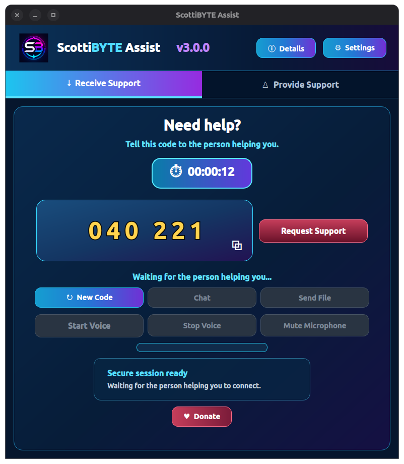
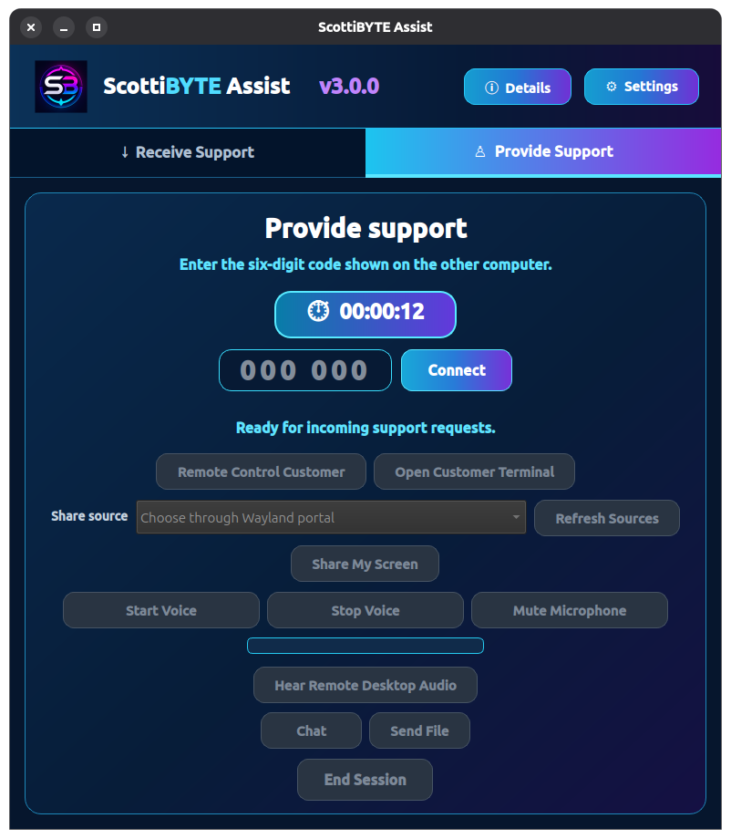

# ScottiBYTE Assist 3.0.0 screenshots

## Client

### Receiver

### Receiver waiting for a provider

### Incoming support request

### Provider ready to connect

### Connected provider

### Connected receiver

### Settings

## Portal

### Public Assist portal

### Portal administrator login

### Authorized providers

The provider names and registration timestamps are blurred in this screenshot.

## Additional screenshot

